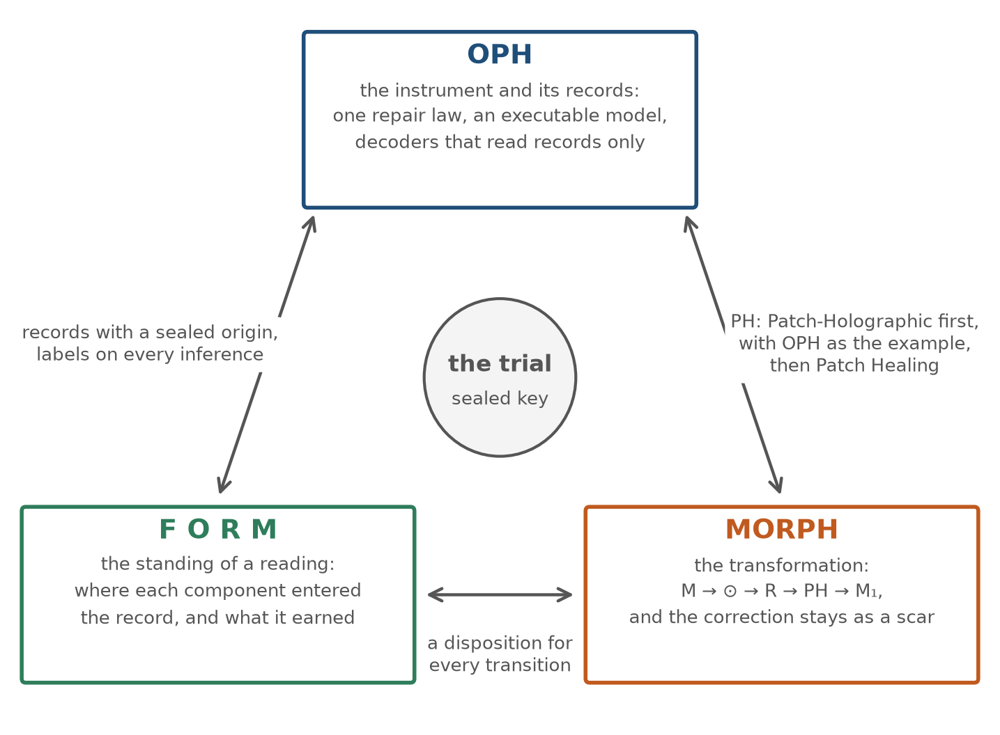
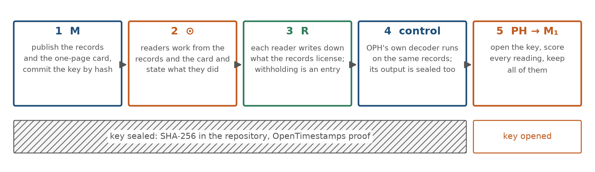
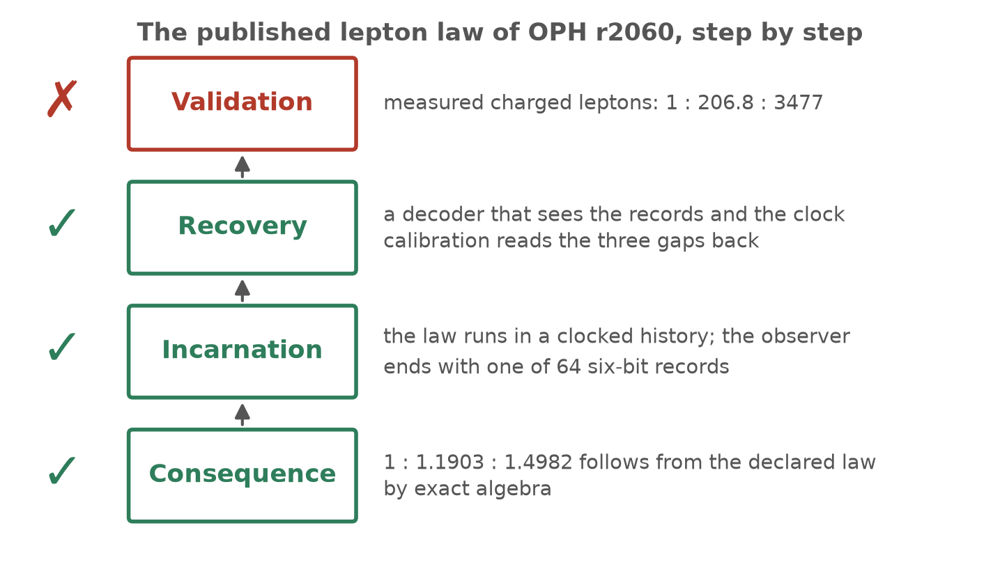
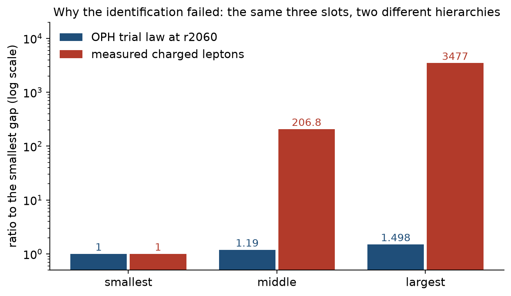
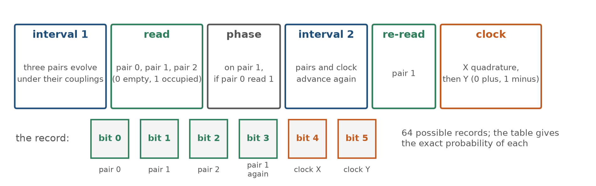
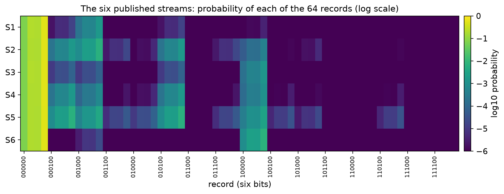

# Recovery trials, explained

Three projects, one exercise, and what the first trial can and cannot tell us.

## Who this is for

Anyone who lands on this repository without having followed the threads on
the Information Physics Institute list. It explains what Observer Patch
Holography, F O R M and MORPH are, why they fit together, how a recovery trial
works, and where the first trial stands. The rules live in
[PROTOCOL.md](../PROTOCOL.md) and in the card of each trial; this page is the
plain version.

## Three projects

### Observer Patch Holography: a theory that runs

Observer Patch Holography (OPH) is Bernhard Mueller's formal theory of
physical reality, built to be consistent, complete and executable. Its
starting point is the observer. An observer keeps records, repairs the damage
that each new interaction does to them, and remembers. The theory has one
local law for that repair and memory, acting on small units called
twelve-port carriers, and everything else is derived from it. Physics, in
this picture, is what observers jointly recover from the records they share.

Two things make OPH unusual. The derivations are machine-checked: more than
12,700 theorems in the Lean proof assistant, with no admitted proofs. And
there is an executable model: code anyone can run, which produces records,
reads them back and prints the numbers. Among the results proved on their
stated domain or executed with retained receipts are the Born rule, the
Tsirelson bound, a slow response with exactly three spatial directions, the
gauge Lie algebra of the Standard Model, a 1+3 causal order with proper time
read from record counts, the Einstein tensor from null balance and
conservation, and dark energy at (w0, wa) = (−1, 0).

What OPH does not have is particles. A particle in OPH is a defect that local
repair cannot undo, and its mass is its upkeep. Several candidate mass laws
have been tried and none reproduces the measured masses. The one that matters
for this repository gave the three charged leptons in the ratio
1 : 1.19 : 1.50; the measured ratio is 1 : 206.8 : 3477. The law and its
failure are both public in the OPH repository, and that is by design.
Condition 4 of the OPH mission is agreement with measurement, with
predictions frozen before the test.

### F O R M: what a reader is entitled to recover

F O R M is Stefaan Vossen's instruction for reading scientific objects. Its
motto: FORM the object. FORMulate the relation. FORMalise only the standing
it survives. A proof assistant starts from declared premises and asks what
follows. F O R M starts from whatever representation is available, a paper, a
dataset, a corpus, a set of records, and asks what a reader may legitimately
recover from it, and with what standing.

Its working parts are labels. Every component of a reading says where it
entered the record: SOURCE-STATED (the source says it), SOURCE-IMPLIED,
RECOVERED (the reader derived it from what the source supplies) or
EVALUATOR-INFERRED (the reader brought it in). A reading as a whole gets a
disposition: CONVERGENT when it agrees with the source and keeps its
distinctions, OVER-RECOVERED when it attributes structure the source does
not support, UNRESOLVED when nothing more specific is justified, and so on.
Two rules matter most here. Independent readers agreeing with each other is
a different thing from any of them being right about the source. And the
instruction applies to itself: its own provenance and drafting history have
to be recoverable in the same way.

F O R M also carries Diana Haskins's stop rule, FER. If establishing a
correspondence would need a bridge the sources do not state, stop there and
record the stop instead of building the bridge.

The closing instruction of F O R M v1.0 says what it is for: "It asks what
happened to the object, under what conditions, what survived the operation,
how that survivor is represented, what standing was actually earned and what
another operator is entitled to do next."

### MORPH: the transformation and its scar

MORPH (Stefaan writes it M⊙RPH) is the youngest of the three. In his words it
is less a new theory than an application successor to F O R M for settings
where information is limited and something gets transformed on the way. It
names the five stations of such a transformation:

- M, the model: the representation actually available;
- ⊙, the operator: the transformation actually performed;
- R, the reconstruction: what the surviving record licenses us to recover;
- PH, patch healing: a successor object in which the effects of the
  transformation, the losses and the corrections stay recoverable instead of
  being erased;
- M₁, the successor model.

The letters PH first stood for Patch-Holographic, with OPH as the
mathematical example at hand; in October Stefaan re-read them as Patch
Healing, keeping OPH as the reference. The healing reading comes with an
image this repository takes seriously. A healed object has passed through an
event, and the event becomes part of its history. If something was
misattributed and later corrected, the correction does not erase the
misattribution; both belong to the successor. That is the scar.

MORPH also supplies five words for comparing what two sides hold, transition
by transition: PRESERVED, CORRESPONDENT, SOURCE-SPECIFIC, UNRESOLVED and
INCOMPATIBLE. And from Stefaan's Constitutional Incarnation work comes a
ladder that suits an executable theory. An illustration depicts a rule. An
incarnation behaves according to the rule, so that the rule can be recovered
from what happens. Validation needs its own, independently justified
conditions. Incarnation is stronger than illustration and weaker than
validation.

## Why the three fit together

All three are about records and what they license, from different sides. OPH
says the world is records and physics is what observers jointly recover from
them. F O R M says a reading is entitled to what the representation licenses,
and no more. MORPH says what happens to a record on its way from one holder
to the next, and insists that the losses and corrections stay visible. Put
the three in one room and the same question arrives from three directions:
what does this record carry?

Each supplies what the others lack.

- OPH gives F O R M an ideal test object. F O R M's usual objects are papers
  and corpora, where nobody holds a key that says what the author meant.
  OPH's executable model produces records from a fully declared instrument,
  so the origin of every record can be written down and sealed before anyone
  reads. For once, a reading can be scored against the truth.
- F O R M gives OPH a discipline for the step OPH got wrong in public. The
  lepton law passed every formal step and failed at the last one, the
  sentence "these three numbers are the electron, muon and tau". No record
  contains that sentence. F O R M has a name for inferences of that kind and
  a rule for withholding them.
- MORPH gives the exercise its shape. The whole transformation is recorded,
  from the records as published to the scored successor object, and the
  wrong readings stay in it as scars. The lepton law's failure is the first
  scar, kept on purpose.
- The directions complete each other. OPH's Lean library runs forward, from
  premises to consequences. F O R M runs backward, from a representation to
  what it entitles. OPH's executable model has decoders that run backward as
  well, reading records with no access to the law that produced them. A trial
  puts the two backward readers, machine and human, on the same records.

None of this validates any of the three. Physical validity stays with
measurement. A trial tests one thing: whether the step from records to names
is licensed by the records or added by the reader.

## How a trial works

1. M. The trial authors publish the record streams with their identities
   removed and their order shuffled, together with a one-page card: what the
   instrument is, what each bit means, which facts the source states, what to
   recover, and how it will be scored. The key (which stream is what, how the
   constructed streams were made, the random seed) is written down and
   hashed, the hash is published, and an OpenTimestamps proof anchors the
   hash in the Bitcoin blockchain, so the date cannot be moved later.
2. ⊙. Readers work from the records and the card alone and say what they did.
   Any tool is allowed, including the instrument's own code.
3. R. Each reader writes down what the records entitle them to recover, with a
   provenance label on every component and a disposition on the whole.
   Withholding is an entry. A reader who meets an unstated bridge stops and
   records the stop.
4. Control. The authors' own decoder reads the same records. Its output is
   sealed with the key, so it can be scored like everyone else's.
5. PH → M₁. After the deadline the key is opened and a public script scores
   every reading against it. Everything is kept: the right readings, the
   wrong ones, the withheld ones, the control, the key, and the authors' own
   mistakes.

### What the scores mean

Each component of each reading gets one of the five MORPH words against the
key. PRESERVED: they agree within the tolerance on the card. CORRESPONDENT:
close, short of the tolerance. SOURCE-SPECIFIC: the reading reports something
the key holds and the records do not carry, or the reverse. UNRESOLVED:
withheld or not settled. INCOMPATIBLE: they disagree. Where a reading
attributes structure the key does not hold, the F O R M label OVER-RECOVERED
is added. Agreement among readers and agreement with the key are reported as
separate numbers, and a majority of readers agreeing on something the key
does not hold is recorded as CONSENSUAL OVER-RECOVERY.

### What a trial does not establish

Recovering the sealed dictionary shows that readers matched a declared
reference. It does not show that the dictionary is uniquely recoverable from
the records; that needs an argument of its own, and reader agreement cannot
supply it. And a trial says nothing about whether OPH's physics is right.
That is decided by measurement.

## Trial 01: the lepton negative control

A negative control is a case where the right answer is known in advance, run
to check that a procedure returns it. Here the known answer is the failed
lepton law.

The law says: the three families of charged leptons are three directions of
OPH's slow response band, a prepared reference state breaks the symmetry
between them, and the masses are fixed multiples of the resulting
eigenvalues. From that, by exact algebra, the three gaps come out in the
ratio 1 : 1.1903 : 1.4982. The law runs as a clocked history in the
executable model; an observer who watches it ends with one of 64 six-bit
records. A decoder that sees the records and the clock calibration reads the
three gaps back to nine decimal places. Then the comparison with measurement:
1 : 206.8 : 3477. The law fails, and a proved bound shows that no law of its
form can reach the measured hierarchy.

Three steps survived and one failed. The step that failed was an
interpretation carried forward: "these three directions are the electron,
muon and tau". That sentence is in no record. Trial 01 asks whether
independent readers, given the records and the card, recover the numbers and
decline the sentence.

### The object

The instrument is public code in OPH release r2060. Three pairs of fermion
modes start empty and evolve under a pairing coupling for one interval; each
pair is read; a conditional phase is applied; a second interval runs; one
pair is read again; and a two-qubit clock that advanced through both
intervals is read in two quadratures. The six readings are the record. The
table of a stream lists all 64 possible records with their exact
probabilities; nothing is sampled.

Six such tables are published. One is the published law, run as published.
The other five were produced by the same instrument from coefficients the
trial authors chose; the card says so and warns that some may coincide with
values a reader recognises. Which is which is sealed.

For each stream a reader reports the three gaps in clock units, an origin
(the published law, unknown, or something else), a particle name for each
slot or WITHHELD, the provenance of each, a disposition, and any stop point.
The scoring script is public, so a reader can see in advance how each field
is scored.

### What is known at sealing

- Protocol 1.0 and trial 01 were frozen and sealed on 3 November 2026. The
  hashes of the key, the control output and the key script are in the trial
  folder with their timestamp proofs.
- The published law's record table regenerates from the pinned OPH code and
  matches the receipt in the OPH repository to one part in 10^14.
- OPH's own decoder, run on the six published streams, recovers every sealed
  value within three parts in a million. That is the control; readers can do
  better or worse.
- The records carry only the size of each coupling. Its complex phase leaves
  the table untouched, so a reader who reports one has read in more than the
  records hold. That is a built-in case of the SOURCE-SPECIFIC disposition.
- Exact tables are needed. From sampled records, gaps below about a
  thousandth of the clock cannot be recovered at any practical sample size.

### What happens next

The deadline is set on the Information Physics Institute list once the
protocol has been read. Readings arrive as pull requests. At the deadline the
key is opened, the script scores everything, and the scores, the key and
every reading go into the repository together. If a later OPH mass law gives
the measured masses, a second trial can ask the harder question: whether
independent readers recover a dictionary from defects to particles that OPH
has sealed in advance.

## Glossary

| term | meaning here |
|:---|:---|
| record | the six bits an observer ends up with after one run of the instrument |
| stream | the table of all 64 records of one run and their probabilities |
| card | the one page a reader works from |
| key | the sealed file that says which stream is what |
| control | OPH's own decoder, run on the published streams, output sealed |
| gap in clock units | the quantity to recover for each pair: its coupling strength relative to the clock's frequency |
| negative control | a case whose right answer is known, run to check the procedure |
| SOURCE-STATED, SOURCE-IMPLIED, RECOVERED, EVALUATOR-INFERRED | F O R M provenance labels: where a component entered the record |
| CONVERGENT, PARTIAL, NON-UNIQUE, UNDER-RECOVERED, OVER-RECOVERED, SEMANTIC DISPLACEMENT, INCOMPATIBLE, UNRECONSTRUCTABLE, JURISDICTION DRIFT, CONSENSUAL OVER-RECOVERY, UNRESOLVED | F O R M dispositions of a reading |
| PRESERVED, CORRESPONDENT, SOURCE-SPECIFIC, UNRESOLVED, INCOMPATIBLE | MORPH comparison words, used by the scorer against the key |
| FER | the stop rule: at an unstated bridge, stop and record the stop |
| scar | a correction kept next to the error it corrects |

## Links

- This repository: https://github.com/muellerberndt/recovery-trials
- The protocol: [PROTOCOL.md](../PROTOCOL.md)
- Trial 01: [trials/01-lepton-negative-control](../trials/01-lepton-negative-control/)
- Observer Patch Holography: https://github.com/FloatingPragma/observer-patch-holography
- F O R M v1.0: https://zenodo.org/records/22875795
- Constitutional Incarnation: https://www.dottheory.co.uk/paper/incarnation
